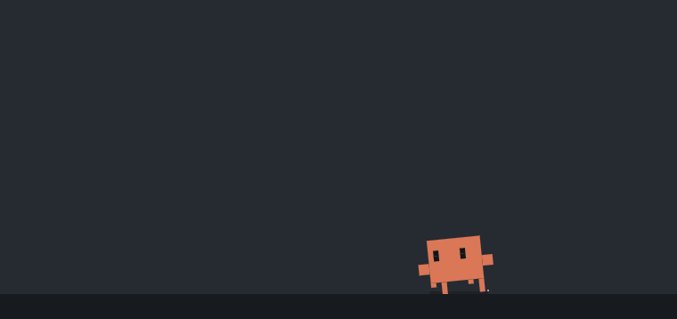
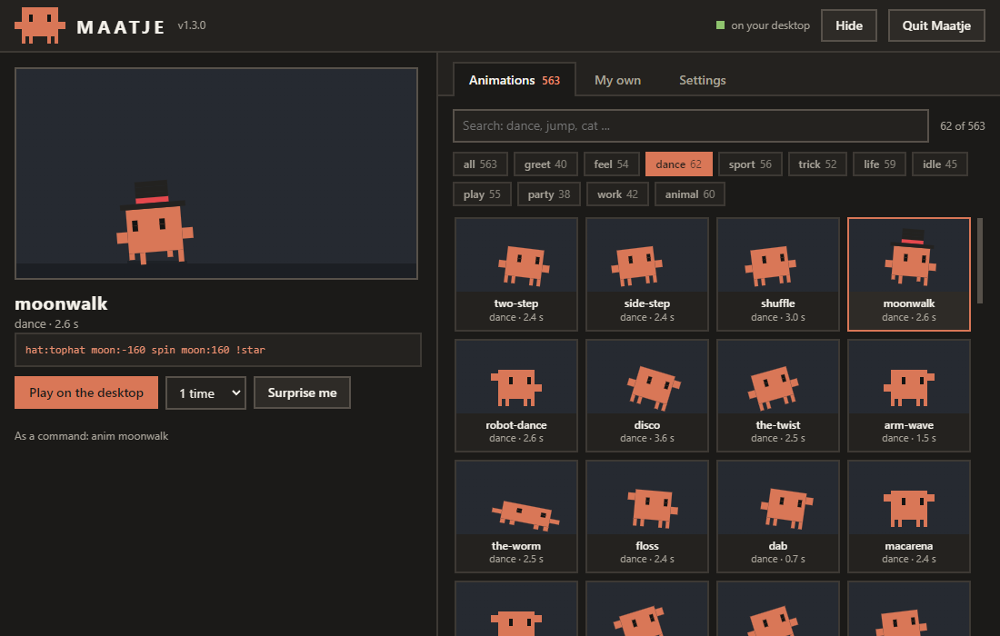

# Maatje

A little orange pixel pet that walks across your desktop, with more than 500 animations, and that
Claude can control.



*Maatje* is Dutch for "little buddy". He stands on top of your taskbar, walks across all your screens,
and does what you or Claude tell him: walk, talk, fly, dance, set off fireworks. He can also follow
along with Claude Code: he types on a tiny laptop while Claude is working and cheers when Claude is done.

This is an unofficial fan project, made by a kid and Claude. It is not affiliated with Anthropic.



## What he can do

- **Walk across your desktop.** He stands on the taskbar and walks over every screen.
  You simply click through him, unless you put the mouse *on* him.
- **More than 500 animations.** Dances, sports, tricks, feelings, animals, party tricks and little things
  he does when he is bored. Pick one in the window, or type `anim moonwalk`.
- **Your own animations.** Drop a GIF or a picture into the window and he turns into it. Or type a line
  of small moves (`hop*2 spin !stars wave`) and watch him do it straight away.
- **Do what Claude says.** About 50 commands in plain words: walk, run, jump, flip, fly, climb the side
  of the screen, run a lap across the ceiling, talk, fireworks, laser eyes, lightning, a sword strike,
  snow, soccer, hats, colors, and friends who copy him.
- **Follow along with Claude Code.** He types while Claude is busy, waves when Claude asks you
  something, and shouts "Done!" when Claude has finished.
- **Play with you.** Click him for a heart, pick him up and throw him, or pet him with the mouse.
- **Potter about by himself** when nobody asks him anything. Stay away long enough and he falls asleep.

## Get him

He only works on Windows 10 or 11.

### The easy way: the program

1. Download `Maatje-...-win64.zip` from the [Releases page](https://github.com/thomheijdemann/maatje/releases).
2. Unpack the zip somewhere and keep the folder together.
3. Double-click `Maatje.exe`.

Windows may say "Windows protected your PC", because the program is not signed. Click "More info" and
then "Run anyway". You do not need Node.js for this.

### From the source

You need [Node.js](https://nodejs.org) 18 or newer.

```
git clone https://github.com/thomheijdemann/maatje.git
cd maatje
npm install
node maatje.js start
```

`npm install` fetches Electron (the program Maatje runs in, about 110 MB). After that you can also
double-click `maatje-start.cmd`. Does Maatje say that Electron has not been unpacked yet? Some versions
of npm skip that step: type `node node_modules/electron/install.js` and start again.

Build the program yourself with `npm run build`. It lands in `dist/Maatje-win32-x64/`.

| What | The program | From the source |
|---|---|---|
| Start | double-click `Maatje.exe` | `node maatje.js start` or `maatje-start.cmd` |
| Open the window | click the icon next to the clock | `node maatje.js open` |
| Quit | the button "Quit Maatje", or right-click the icon next to the clock | `node maatje.js quit` or `maatje-stop.cmd` |
| Hide for a while (a game, a recording) | the button "Hide" | right-click the icon next to the clock |

He does not start by himself when you turn on your pc. The icon next to the clock may be tucked away
under the little `^` arrow.

## The window

- **Animations**: every animation with a little picture. Click one and he shows it on the stage on the
  left, again and again. "Play on the desktop" (or a double click) makes the real one do it. You can
  search (`dance`, `jump`, `cat`, a thing like `guitar`) and pick a kind.
- **My own**: your own animations, see below.
- **Settings**: wander around by himself or not, sound, color, size, hat, connecting to Claude Code, and
  a box to type commands into.

Closing the window does not stop Maatje. Click the icon next to the clock to get it back.

## Animations

```
node maatje.js anim victory-dance
node maatje.js "anim moonwalk 3; anim random dance"
node maatje.js anims            the whole list
node maatje.js anims frog       search the list
```

`anim <name>` plays one, `anim <name> 3` three times in a row, `anim random` a surprise and
`anim random dance` a surprise of one kind. The kinds are: greet, feel, dance, sport, trick, life, idle,
play, party, work, animal, and mine (your own). If he has friends (`clone 3`), they copy him.

## Your own animations

Everything you add is kept in `%APPDATA%\Maatje\animations` and shows up under the kind "mine".

**A GIF or a picture.** Drop a GIF, PNG, WebP or JPG on the window (at most 8 MB). While it plays, he
*is* your picture: `anim my-gif`. With "Look like this" (or `skin my-gif`) he looks like it all the time,
also when he walks. `skin off` makes him himself again.

**Moves you type yourself.** In the tab "My own" you type small moves after each other and he does them
on the stage straight away. Give it a name and click Save. A `.txt` file with such a line works too.

```
hop*2 spin !stars wave                 two hops, a spin, stars, a wave
prop:guitar [ swl swr ]*4 jump&twirl   hold a guitar, sway four times, jump and twirl it at the same time
eyes:happy go:200 flip go:-200         walk 200 pixels to the right, a flip, and back
```

| You type | It means |
|---|---|
| `hop` | a move |
| `hop*3` | three times |
| `hop:2` | bigger (for `go`, `dash`, `moon` and `slide`: how many pixels, a minus is to the left) |
| `hop/0.2` | in 0.2 seconds |
| `jump&spin` | two moves at the same time |
| `[ hop spin ]*2` | a group, twice |
| `tempo:2` | everything after it twice as fast |
| `eyes:happy`, `prop:book`, `au` | something that stays until you change it |
| `!stars`, `!text:WOW`, `!snd:pop` | a little effect, right now |

- **Moves**: `w` (wait) `hop` `jump` `leap` `dip` `duck` `rise` `swl` `swr` (sway) `tl` `tr` (tilt) `lean` `back`
  `spin` `flip` `bflip` `roll` `cart` `hstand` `squash` `stretch` `puff` `shrink` `shake` `shiver` `wobble`
  `nod` `bob` `march` `jog` `tap` `kick` `stomp` `wave` `wavel` `waver` `reach` `flap` `alt` `pump` `clap`
  `lunge` `recoil` `float` `lie` `faint` `blink` `peek` `swing` `raise` `twirl` (those three move the thing in
  his hand) `rope` `hoop` `go` `dash` `moon` `slide`
- **Things that stay**: `au` `ad` (arms up, down) `al:-3` `ar:-3` (one arm) `sit` `stand` `eyes:happy`
  `look:l` (l, r, u, d, c) `face:flip` (l, r, flip) `prop:book` `noprop` `hat:crown` `nohat` `color:blue`
  `nocolor` `ghost:0.4` `solid` `scale:1.5` `legs:tuck` (tuck, long, norm)
- **Effects**: `!hearts` `!stars` `!notes` `!sparks` `!zap` `!dust` `!smoke` `!cloud` `!tears` `!drops`
  `!bubbles` `!fire` `!confetti` `!text:WORD`, the signs above his head `!heart` `!star` `!note` `!q` `!ex`
  `!angry` `!sweat` `!idea` `!zzz`, and the sounds `!snd:pop` (pop, jump, land, boom, zap, swish, ding,
  kick, bonk, warp, grow)
- **Things in his hand**: book, phone, cup, flower, flag, wand, torch, balloon, umbrella, barbell, dumbbell,
  guitar, mic, brush, hammer, rod, ball, gift, cake, icecream, camera, magnifier, shield, trophy, pencil,
  lantern, heart, star, apple, sword, laptop

In the window you can click all of these words to add them. If there is a mistake in a line, he tells
you which word he does not know.

## Giving commands

```
node maatje.js say Hi!
node maatje.js "walk middle; jump high; cheer"
node maatje.js help
```

`node maatje.js help` lists every command with an example. Inside this folder you can also type the
short form: `maatje say Hi!`. With the program you do not need Node.js:

```
Maatje.exe --do="walk middle; say Hi!; anim victory-dance"
```

(With the program, `maatje.js` is in the folder `resources\app`.)

| Kind | Commands |
|---|---|
| Movement | `walk`, `run`, `sneak`, `jump`, `flip`, `spin`, `teleport`, `fly`, `land`, `climb`, `lap` |
| Talking | `say`, `think`, `shout`, `whisper`, `quiet` |
| Feelings | `emote`, `eyes`, `look`, `wave`, `cheer`, `nod`, `shake`, `bow`, `startle`, `dance`, `sit`, `stand`, `sleep`, `wake`, `type` |
| Animations | `anim` |
| Effects | `fireworks`, `laser`, `lightning`, `rainbow`, `snow`, `title`, `sword`, `ball`, `kick`, `soccer` |
| Looks | `color`, `size`, `hat`, `skin` |
| Friends | `clone`, `cleanup` |
| Claude | `work`, `follow` |
| Other | `wait`, `stop`, `roam`, `sound`, `hide`, `come` |

A place can be: `left`, `middle`, `right`, `anywhere`, `mouse`, `50%`, `s2:50%` (second screen),
`+200` or `-200` (pixels further) or a pixel.

Maatje was born in the Netherlands, so the Dutch words work as well: `loop midden` is the same as
`walk middle`, and `zeg Hoi!` is the same as `say Hi!`. The help shows them in brackets.

## Letting Claude control him

Tell Claude Code where Maatje lives, for example in your `CLAUDE.md`:

```
Maatje, a little pet on the desktop, is running on this pc, and you can control him.
All commands:   node C:/path/to/maatje/maatje.js help
All animations: node C:/path/to/maatje/maatje.js anims
Example:        node C:/path/to/maatje/maatje.js "walk middle; shout Done!; anim victory-dance"
```

Handy for Claude:

- `--wait` after a command: only come back when Maatje has finished.
- `node maatje.js status`: where he is and what he is doing.
- `node maatje.js photo picture.png --around`: a picture of what Maatje is drawing right now
  (only Maatje himself, never your screen).
- Every command starts Maatje by itself if he is not running yet.

## Following along with Claude Code

Click **Connect** in the window (the tab Settings), or type:

```
node maatje.js connect
```

This adds a few lines ("hooks") to `~/.claude/settings.json`. Whatever was already there stays, and a
backup is made first. From then on:

| What Claude does | What Maatje does |
|---|---|
| Claude is busy | he sits typing on his little laptop, with a thinking break now and then |
| Claude starts a helper (a subagent) | a friend joins him and types along |
| Claude asks you something or wants permission | he stops, waves and says "Can you take a look?" |
| Claude has finished his turn | he cheers and shouts "Done!" |

- The hook only tells Maatje *what* is happening (working, done, needs you) and for which session.
  It does not pass on what you type or what Claude is doing.
- If Maatje is not running, nothing happens.
- Off for a while: untick "Follow along with Claude Code" in the window.
- Gone completely: **Disconnect** in the window, or `node maatje.js disconnect`. Do that before you move
  or delete the folder too, otherwise Claude Code reports at every step that it cannot find the hook.

## Making your own show

A show is a text file in the `shows` folder, with one command per line. Look at `shows/hello.txt` for a
small example. Play it with `node maatje.js play hello`.

```
# a line with # is an explanation
walk middle
wave
say Hi {name}!
+say I talk while I walk
walk +200
repeat 3
jump
end
anim victory-dance
```

- `+` in front of a command: do not wait until it is done.
- `repeat 3` ... `end`: that part three times.
- `{name}` becomes the name you are signed in with on your pc.
- If there is a typo in it, he tells you which line it is and does nothing.

## How it is put together

- `app/main.js`: one transparent window over all your screens (always on top, never takes focus, clicks
  go through it), the app window, the icon next to the clock, the folder with your own animations, and a
  named pipe over which commands come in. No network port is opened.
- `app/js/figuur.js`: how the little guy is drawn and how he moves (14 by 10 pixels, all in code).
- `app/js/acties.js`: all commands. A new command is one small block `opdracht('name', {...})`;
  the help, the language and the test pick it up by themselves.
- `app/js/anim.js`: the animations: the small moves, the things he can hold, and reading a GIF.
  `app/js/anim-data.js`: the built-in animations, one line each. A new one is one more line.
- `app/paneel.html`, `app/js/paneel.js`: the app window. Its stage runs the very same code as the guy on
  the desktop.
- `app/js/fx.js`: fireworks, laser, lightning, snow, the ball. `app/js/letters.js`: his own pixel letters.
- `app/js/brein.js`: what he does by himself, the mouse, and following along.
- `maatje.js`: the remote control. `hook.js`: the script Claude Code calls. `koppel.js`: connecting.
- `tools/build-exe.js`: builds `Maatje.exe` and draws its icon.
- The sound is made in code (soft beeps). Turn it off in the window or with `node maatje.js sound off`.

The code itself is written in Dutch: the names of the functions and the comments. Each file starts with
a short explanation in English. Everything you see as a user is English.

Test without a window: `npm test`. It starts the real program invisibly, moves time forward by hand and
checks everything: every command, every animation, your own animations, the app window, the mouse,
following along, and that nothing is left behind on the screen. To test the built program instead, set
`MAATJE_EXE` to the path of `Maatje.exe` first. Make the clip at the top again with
`node tools/make-gif.js` (needs ffmpeg).

## Good to know

- Made and tested on one pc: Windows 10, two screens of 1920 by 1080.
- Screens with a different scaling than your main screen do not take part.
- With a full-screen game it is better to hide him.
- The program is not signed, so Windows warns the first time you start it.
- The sound was made by an AI that cannot hear. If it sounds ugly, turn it off.

## Unofficial

Maatje is a fan project. The little guy is drawn after the Claude Code mascot, and that mascot belongs
to [Anthropic](https://www.anthropic.com). This project is not part of Anthropic and was not made or
approved by Anthropic. "Claude" is a trademark of Anthropic.

The code has the MIT license (see `LICENSE` and `NOTICE.md`): you may use it, change it and pass it on.
Almost all of the code was written by Claude, at the request of the maker.
